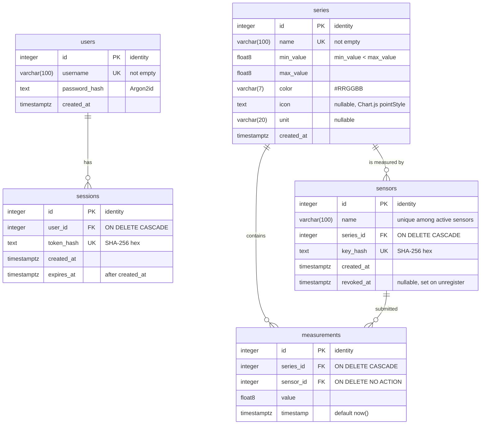

# Database schema (ERD)

## Tables

| Table          | Purpose                                                                                                                                                                                                                                                                             |
| -------------- | ----------------------------------------------------------------------------------------------------------------------------------------------------------------------------------------------------------------------------------------------------------------------------------- |
| `users`        | Administrator accounts. Only an Argon2id hash of the password is stored. The first admin is created by `db:seed`.                                                                                                                                                                   |
| `sessions`     | Login sessions. The token is given to the client once; only its SHA-256 hash is stored, with an expiry time. Logging out deletes the row.                                                                                                                                           |
| `series`       | A measurement series (e.g. outdoor temperature): name, allowed value range, unit, and how it is drawn on the chart – colour plus point style, so series are not told apart by colour alone.                                                                                         |
| `sensors`      | Registered sensors. Each belongs to one series and authenticates with an API key, stored only as a SHA-256 hash. Unregistering sets `revoked_at` (soft delete), so the sensor's measurements keep a valid `sensor_id`.                                                              |
| `measurements` | Immutable results submitted by sensors: value and time. `series_id` is stored directly (the series of the submitting sensor), so the main query – one or more series in a time range – uses a single index without a join. Values outside the series range are rejected by the API. |

## Relationships

| Relationship               | Cardinality                                    | When the parent row is deleted                                                                    |
| -------------------------- | ---------------------------------------------- | ------------------------------------------------------------------------------------------------- |
| `users` → `sessions`       | one user has zero or more sessions             | **cascade** – the user's sessions are removed                                                     |
| `series` → `sensors`       | one series has zero or more sensors            | **cascade** – the series' sensors are removed and their keys stop working                         |
| `series` → `measurements`  | one series has zero or more measurements       | **cascade** – the series' measurements are removed                                                |
| `sensors` → `measurements` | one sensor submitted zero or more measurements | **no action** – a sensor with measurements cannot be hard-deleted; unregistering is a soft delete |

## Constraints and indexes

| Name                                            | Type                 | Rule / purpose                                                               |
| ----------------------------------------------- | -------------------- | ---------------------------------------------------------------------------- |
| `series_min_below_max`                          | CHECK                | `min_value < max_value`                                                      |
| `series_color_hex`                              | CHECK                | `color` matches `^#[0-9A-Fa-f]{6}$`                                          |
| `series_icon_point_style`                       | CHECK                | `icon` is NULL or a Chart.js point style (`circle`, `cross`, …, `triangle`)  |
| `*_name_not_empty`                              | CHECK                | `users.username`, `series.name` and `sensors.name` are not empty             |
| `*_hash_sha256`                                 | CHECK                | `sessions.token_hash` and `sensors.key_hash` are 64 lowercase hex characters |
| `sessions_expires_after_created`                | CHECK                | `expires_at > created_at`                                                    |
| `sensors_active_name_unique`                    | partial UNIQUE index | sensor names are unique among sensors with `revoked_at IS NULL`              |
| `measurements_series_id_timestamp_idx`          | index                | `(series_id, timestamp)` – measurements of given series in a time range      |
| `measurements_sensor_id_timestamp_idx`          | index                | `(sensor_id, timestamp)` – latest measurement of a sensor                    |
| `sensors_series_id_idx`, `sessions_user_id_idx` | index                | foreign-key lookups and cascading deletes                                    |
